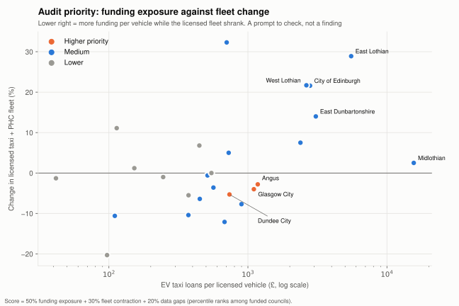
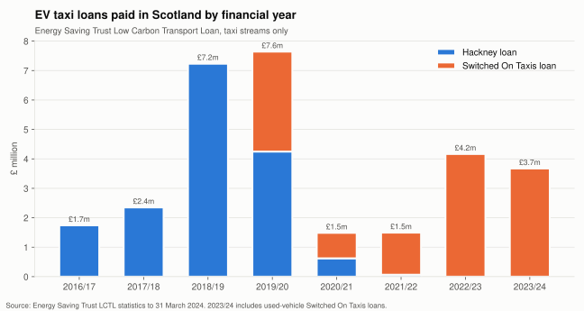
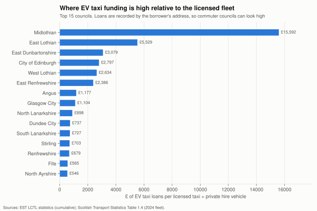
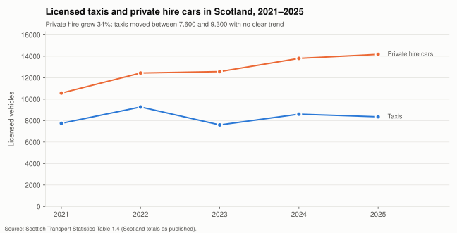

# Scotland EV Taxi Funding – Compliance Risk Monitor

**A Power BI project that joins five years of Scottish government open data to show where public money for electric taxis went, whether licensed taxi fleets kept pace, and which council areas an auditor should sample first.**



> **What this is and is not.** This project flags *patterns worth checking*. It does not identify, accuse or imply wrongdoing by any person, business or council. The open data is aggregated by council, so it cannot show what happened to any single vehicle. A high score means "sample here first", not "misuse found".

---

## The question

Scotland has offered interest-free loans for electric taxis since 2016: first the Hackney loan, and since 2019 **Switched On Taxis**. The UK Plug-in Taxi Grant also applies. A known risk with vehicle subsidies is that a car is bought with taxi funding, removed from the taxi licence soon after, and then sold or used privately as an ordinary used car.

Using only open government data, this project asks three things:

1. **Where did EV taxi funding go?** Which councils, and in which years.
2. **Did the licensed taxi and private hire fleet keep pace in those areas?** Taxi and PHC counts for 2021–2025.
3. **Which areas should a compliance review look at first, and what data would settle it?**

## Key findings

| | |
|---|---|
| **£29.8m** | EV taxi loans paid to the end of 2023/24: £16.3m Hackney (2016/17–2021/22) and £13.5m Switched On Taxis (2019/20–2023/24) |
| **54%** | Share going to Edinburgh and the three Lothian councils (Edinburgh alone: £11.2m, 37.5%) |
| **£15,592** | EV taxi loans per licensed taxi or PHC vehicle in Midlothian, against £546–£3,079 in most funded councils. Loans are recorded by the borrower's home address, so this probably reflects Edinburgh drivers living in Midlothian. It is a data-design caveat, not a red flag in itself |
| **+34%** | Growth in Scotland's private hire cars, 2021→2025 (10,566 → 14,173). Taxis stayed between 7,600 and 9,300 |
| **+376%** | Growth in privately kept battery-electric cars in Scotland, 2021→2025 (13,733 → 65,340). Ex-taxi EVs would be a very small part of this |
| **3 councils** | Dundee City, Glasgow City and Angus come out as *higher* audit priority: above-median funding exposure, a shrinking licensed fleet, and gaps in the published fleet data |
| **48** | Data-quality issues found in the official tables, 7 of them high severity, all logged in [`data_quality_log.csv`](data/clean/data_quality_log.csv) |







## Data sources (all open, all official)

| Source | Publisher | What it gives | Years |
|---|---|---|---|
| [Scottish Transport Statistics](https://www.transport.gov.scot/publications/?publicationtype=statistics), Table 1.4 | Transport Scotland | Licensed taxis, private hire cars, driver licences and wheelchair-accessible vehicles by council | 2021–2025 editions |
| [Low Carbon Transport Loan statistics](https://energysavingtrust.org.uk/wp-content/uploads/2024/04/Energy-Saving-Trust-Low-Carbon-Transport-Loan-Statistics-up-to-and-incl-31.03.2024.pdf) | Energy Saving Trust, for Transport Scotland | £ loaned by council and by financial year for each stream (Hackney, Switched On Taxis, business, domestic, used EV) | 2011/12–2023/24 |
| [FOI 202300344586](https://www.transport.gov.scot/) | Transport Scotland | Number of loans by stream and council | 2022/23 |
| [VEH0142](https://www.gov.uk/government/statistical-data-sets/vehicle-licensing-statistics-data-tables) | DfT / DVLA | Licensed plug-in cars by local authority, fuel and keepership (private or company) | 2020 Q4 – 2026 Q2 |
| [Vehicle Enquiry Service API](https://developer-portal.driver-vehicle-licensing.api.gov.uk/) | DVLA | Per-vehicle `dateOfLastV5CIssued` and fuel type. Used only in the authorised-auditor template | live |

All source extracts are in [`data/raw`](data/raw), with values exactly as published (including `[unavailable]` markers). Contains public sector information licensed under the [Open Government Licence v3.0](https://www.nationalarchives.gov.uk/doc/open-government-licence/version/3/).

## How it works

```
data/raw/                 official extracts, untouched
   │
   ▼  scripts/build_dataset.py
   │   • maps every council-name spelling to its ONS S12 code (32 councils)
   │   • converts suppressed or unavailable markers to blanks
   │   • checks every row and column total against the published totals
   │   • flags duplicates, totals that don't add up, and big year-on-year swings
   │   • builds council risk indicators
   ▼
data/clean/               star schema for Power BI
   ├─ dim_council.csv
   ├─ fact_taxi_fleet.csv               council × year, with quality_flag / is_reliable
   ├─ fact_taxi_fleet_scotland.csv      published national totals
   ├─ fact_ev_taxi_funding_by_council.csv
   ├─ fact_funding_by_year.csv          stream × financial year
   ├─ fact_loan_counts_2022_23.csv
   ├─ fact_plugin_cars.csv              council × quarter × fuel × keepership
   ├─ council_risk_indicators.csv
   └─ data_quality_log.csv
   │
   ▼  powerbi/   measures.dax · theme JSON · Power Query loader · REPORT_GUIDE.md
```

### Audit priority score

The score is calculated for each of the 26 councils that received EV taxi funding. Each component is a percentile rank among those councils (0–100).

| Component | Weight | Measure |
|---|---|---|
| Funding exposure | 50% | EV taxi loans (£) ÷ licensed taxi + PHC vehicles (2024, or the nearest reliable year) |
| Fleet contraction | 30% | % change in licensed vehicles, earliest reliable year (2021–23) → latest (2024–25), reversed so that shrinking scores higher |
| Data gaps | 20% | Years with unreliable fleet data plus years with large swings |

Tiers: **Higher** ≥ 70, **Medium** 45–70, **Lower** < 45. The weights are a judgement call and are kept in one place in the script so a reviewer can change them.

## Limitations, stated plainly

- **No vehicle-level link in open data.** Funding is published by council, not by vehicle. Nothing here can show that a specific funded car left taxi use.
- **Borrower address ≠ licensing council.** Loans are counted where the borrower lives, while taxis are licensed where they work. Commuter councils, such as the Lothians around Edinburgh, look over-funded for this reason.
- **Leasing head offices.** Company-kept EVs in VEH0142 are counted at the registered keeper's address. Renfrewshire and Stirling hold large leasing fleets, so use private keepership for local comparisons.
- **Mismatched periods.** Funding is cumulative from 2016, while fleet counts are snapshots for 2021–2025. Loans paid in 2016–2019 may relate to vehicles already replaced.
- **Fleet data quality.** 14 of 160 council-year fleet rows are unavailable or internally inconsistent; they are excluded from measures through `is_reliable`. Examples:
  - 2021: Highland's row duplicates East Dunbartonshire's.
  - 2022: Glasgow's published total is 3,564 when its parts add to 4,564.
  - 2023: Dundee's published total is 653 when its parts add to 467.
- **The UK Plug-in Taxi Grant** is paid through dealers, and no recipient list by council is published.
- **Funding table discrepancy.** The EST yearly table's grand total is £101,462 higher than the sum of its years, in both the business and total columns. The council table matches the grand total, so this looks like a source error and is logged rather than corrected.

## What would actually settle the question

1. **FOI requests** for aggregate loan outcomes (early repayment, recall, licence surrender within 24 months) from Transport Scotland and each council. Templates are in [`docs/FOI_TEMPLATES.md`](docs/FOI_TEMPLATES.md). The key new indicator would be the **early-exit rate** by council.
2. **An authorised vehicle-level check.** A body that already holds the funded-vehicle list lawfully can run [`scripts/vehicle_level_check_template.py`](scripts/vehicle_level_check_template.py). It queries the DVLA Vehicle Enquiry Service and flags vehicles with a new V5C logbook, or an ended taxi licence, within N months of funding. This repository holds **no registration numbers** and never should. `data/private/` is git-ignored.

## Run it

```bash
pip install -r requirements.txt
python scripts/build_dataset.py     # rebuild data/clean and the quality log
python scripts/make_charts.py       # rebuild images/
```

Then follow [`powerbi/REPORT_GUIDE.md`](powerbi/REPORT_GUIDE.md) to build the five-page report: Overview, Fleet vs funding, Where funded EVs end up, Audit priority, and Data quality.

## Skills shown

Public-sector data sourcing (xlsx, ODS and PDF tables) · data cleaning and validation in Python/pandas · reconciliation against published totals · star-schema modelling · DAX · Power Query (M) · risk scoring with documented weights · data-quality logging · UK GDPR-aware design · FOI-based next steps

---

*Author: [Vidya Vishnuvihar Geetha](https://vidyavgeetha.github.io) · Data analyst, Scotland · Code: MIT licence · Data: Open Government Licence v3.0*
